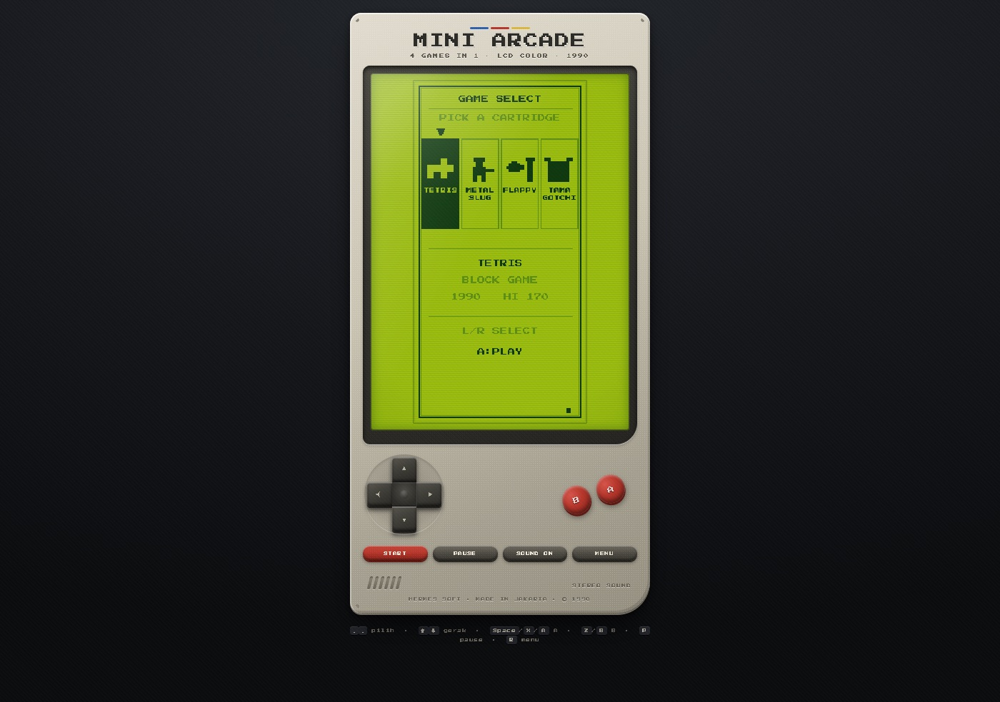
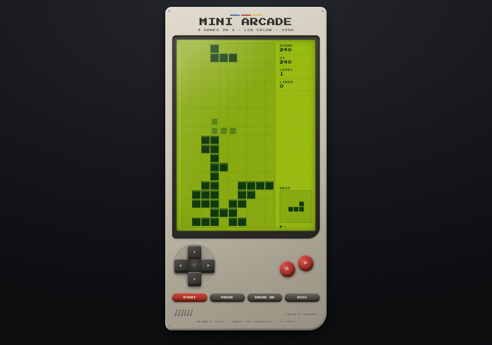
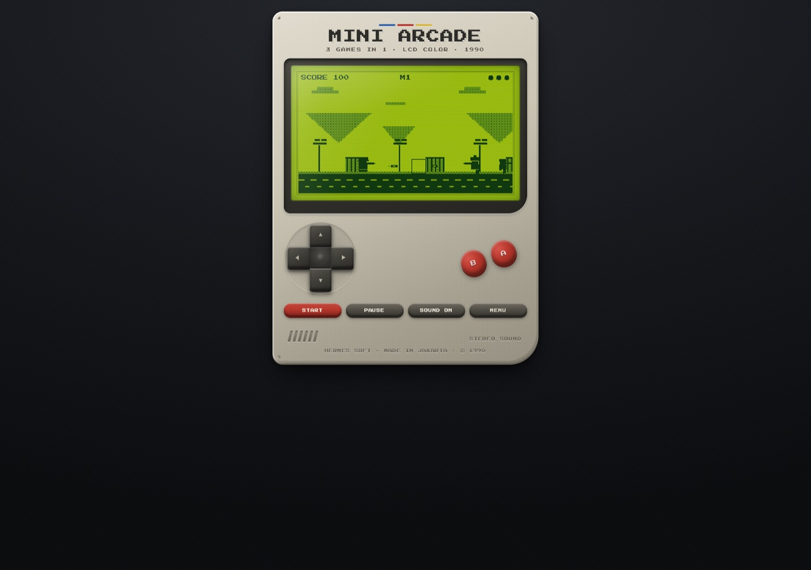
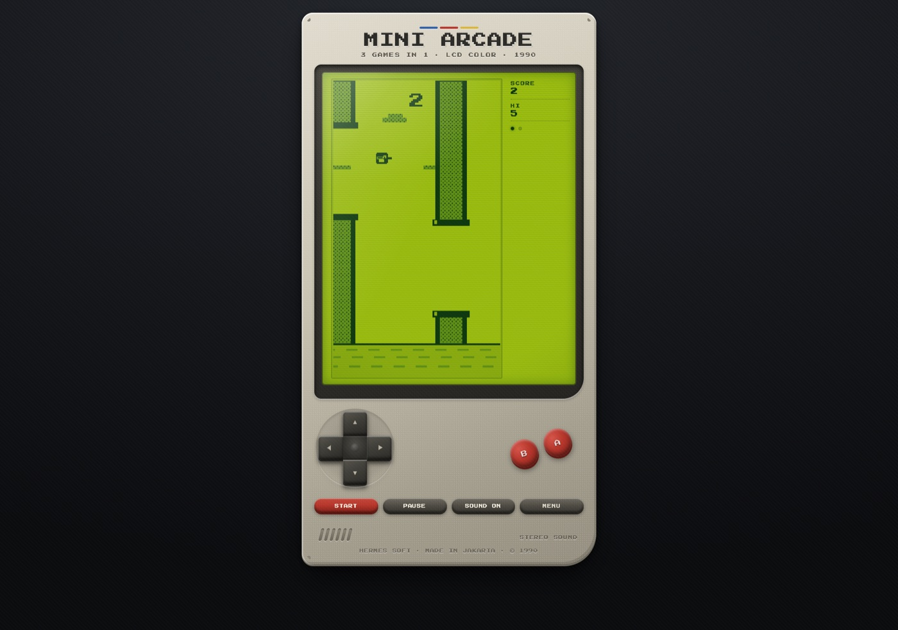
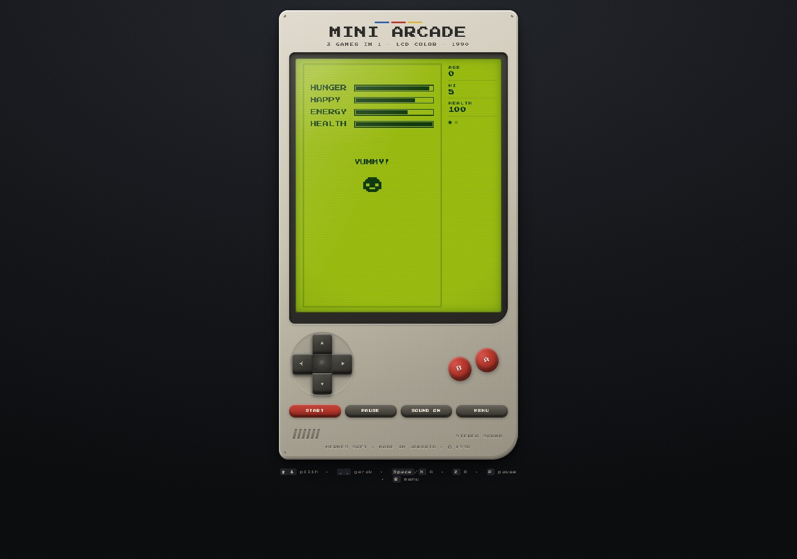

# MINI ARCADE — 4 Games in 1 (Handheld LCD 1990)

Empat game klasik dalam **satu handheld LCD era 90-an**: Tetris, Metal Slug, Flappy Bird, dan Tamagotchi.
Bodi plastik beige, layar LCD hijau dengan scanline, D-pad, tombol A/B merah, speaker grille,
sampai stiker "© 1990" di bawah. Bukan full screen — device-nya berdiri di tengah halaman dan
mengecil sendiri kalau layar pendek.

Pilih game dari menu cartridge, semua dirender monokrom di layar LCD yang sama.



| Tetris | Metal Slug |
| --- | --- |
|  |  |

| Flappy | Tamagotchi |
| --- | --- |
|  |  |

## Main sekarang

- **Online:** <https://andriyfm.github.io/tetris-browser-game/>
- **Lokal:** buka `index.html` langsung di browser, atau

  ```bash
  python3 -m http.server 8000
  # lalu buka http://localhost:8000
  ```

Tanpa install, tanpa build step, tanpa dependency. Font pixel di-vendor lokal, jadi tetap
tampil benar walau offline.

## Game yang tersedia

### 1. TETRIS — *Block Game (1990)*
Papan 10 × 20, tujuh tetromino, **7-bag randomizer**, rotasi dua arah dengan wall kick,
ghost piece, level naik tiap 10 baris. Skor klasik: single 40, double 100, triple 300,
tetris 1200 — dikali level.

### 2. METAL SLUG — *Run & Gun (1996)*
Side-scroller satu layar dengan kamera bergerak, parallax tiga lapis (awan, gunung, palem + pagar),
prajurit berhelm, dua tipe musuh:
- **Grunt** — mendekat lalu menembak; helm berjambul jadi pembeda dari pemain.
- **Charger** — lari kencang dan menyerang jarak dekat.

3 nyawa, tembakan otomatis saat **B** ditahan, bidik ke atas dengan **↑**, dan misi berganti
setiap kali kamu mencapai ujung stage (+500 bonus). Kesulitan naik per misi.

### 3. FLAPPY — *One Button (2013)*
Fisika gravitasi + impuls kepak, pipa dengan celah acak, kecepatan naik seiring skor,
ground scroll, dan skor besar di tengah layar.

### 4. TAMAGOTCHI — *Virtual Pet (1996)*
Rawat makhluk pixel: **FEED**, **PLAY**, **SLEEP**, **CLEAN**. Tiga stat (lapar, senang,
energi) turun seiring waktu; kalau ada yang habis, nyawa (HEALTH) ikut berkurang. Kotoran
muncul berkala dan menurunkan kebahagiaan sampai dibersihkan. Skor = **usia dalam hari**
(1 hari ≈ 6 detik). Makhluk mati kalau terus diabaikan — jaga sampai tumbuh besar.

Tekan **A** untuk membuka menu aksi, **↑ / ↓** untuk memilih, **A** untuk konfirmasi,
**B** untuk menutup. Ekspresi wajah makhluk berubah sesuai kondisinya (idle, makan, tidur,
senang, sedih, mati).

## Kontrol

**Global**

| Aksi | Keyboard | Tombol device |
| --- | --- | --- |
| Pilih game (grid) | `←` `→` (atau `↑` `↓`) | D-pad kiri / kanan |
| Tombol A | `Space` / `X` / `A` | `A` |
| Tombol B | `Z` / `B` | `B` |
| Pause / lanjut | `P` | `PAUSE` |
| Mulai / ulang ronde | `Enter` | `START` |
| Kembali ke menu | `R` / `Esc` | `MENU` |
| Suara on/off | — | `SOUND ON` |

**Per game**

| Game | D-pad | A | B |
| --- | --- | --- | --- |
| Tetris | `←` `→` geser, `↓` turun, `↑` putar | jatuh langsung | putar balik |
| Metal Slug | `←` `→` lari, `↑` bidik atas | lompat | tembak (tahan = auto) |
| Flappy | — | kepak | kepak |
| Tamagotchi | `↑` `↓` pilih menu aksi | buka menu / konfirmasi | tutup menu |

Tombol device bisa diklik/ditap dan punya **auto-repeat** saat ditahan (geser/turun).
Semua tombol punya `aria-label`.

## Struktur project

```
.
├── index.html               # cangkang device: brand, bezel, layar, D-pad, A/B, pill
├── styles.css               # bodi plastik, bezel, LCD, tombol, media query
├── js/
│   ├── lcd.js               # toolkit LCD: palet, dither, teks pixel, sprite, SFX
│   ├── menu.js              # layar GAME SELECT (kartrid)
│   ├── tetris.js            # game 1
│   ├── metalslug.js         # game 2
│   ├── flappy.js            # game 3
│   ├── tamagochi.js         # game 4
│   └── main.js              # wiring device, loop, input, panel skor, auto-fit
├── assets/fonts/            # Press Start 2P (woff2) + lisensi OFL
├── docs/                    # screenshot README
└── tests/smoke.console.js   # smoke test 38 cek (jalankan di Console browser)
```

## Detail teknis

- **Satu layar, banyak game.** Setiap game mendeklarasikan ukuran kanvas logis dan rasio
  layarnya sendiri: Tetris 180×360 (1:2), Metal Slug 320×180 (16:9), Flappy 180×320,
  Tamagotchi 180×320.
  Device menyesuaikan tinggi bezel, lalu auto-fit menghitung ulang skala.
- **Kontrak game seragam:** `{ w, h, boardMax, usePanel, labels, create(api) }` dan instance
  dengan `reset()`, `update(dt)`, `render(ctx)`, `input(action)`, `state`.
  Menu adalah game biasa, jadi tidak ada jalur kode khusus.
- **Rendering:** kanvas logis × `devicePixelRatio`, `ctx.setTransform(dpr,…)`,
  CSS `width:100%` + `image-rendering: pixelated`.
- **Palet LCD 3 nada:** `bg`, `mid` (dither 50%), dan `ink`, plus dither 25% untuk latar jauh —
  supaya sprite selalu lebih tegas dari latar di layar monokrom.
- **Loop:** `requestAnimationFrame` dengan `dt` di-clamp 100 ms. Fisika memakai **detik**
  (`dt/1000`), timer UI memakai milidetik.
- **Audio:** WebAudio oscillator `square` + noise buffer untuk ledakan. Tanpa file audio.
- **Auto-fit:** `transform: scale(k)` + margin negatif, dihitung ulang setiap ganti game.

## Debug & pengujian

Tambahkan `?debug=1` pada URL untuk membuka `window.__game`:

```js
__game.launch('metalslug')     // pindah game
__game.startRound()            // mulai ronde
__game.input('a')              // kirim aksi (left/right/up/down/a/b)
__game.held('right', true)     // tahan tombol
__game.step(16, 60)            // majukan 60 frame × 16 ms tanpa menunggu rAF
__game.game.debugState()       // angka state: skor, hp, posisi, jumlah musuh/pipa
__game.menu()                  // kembali ke menu
```

**Smoke test:** buka `index.html?debug=1`, tempel isi `tests/smoke.console.js` ke Console.
Hasilnya **38 cek PASS/FAIL** yang mencakup: boot menu + navigasi grid kiri/kanan, Tetris (blok terkunci, skor, panel),
Metal Slug (gerak, lompat, mendarat, menembak), Flappy (gravitasi, kepak, skor pipa),
Tamagotchi (usia & stat berjalan, menu aksi, FEED/PLAY, mati saat diabaikan), dan kembali ke menu.

## Lisensi

- Kode: **MIT** — lihat [LICENSE](LICENSE).
- Font *Press Start 2P*: **SIL Open Font License 1.1** — lihat `assets/fonts/OFL.txt`.

Tetris, Metal Slug, dan Flappy Bird adalah merek dagang pemiliknya masing-masing.
Project ini dibuat untuk latihan/tujuan edukasi, tanpa aset dari game aslinya, dan tidak
berafiliasi dengan pemegang merek.
