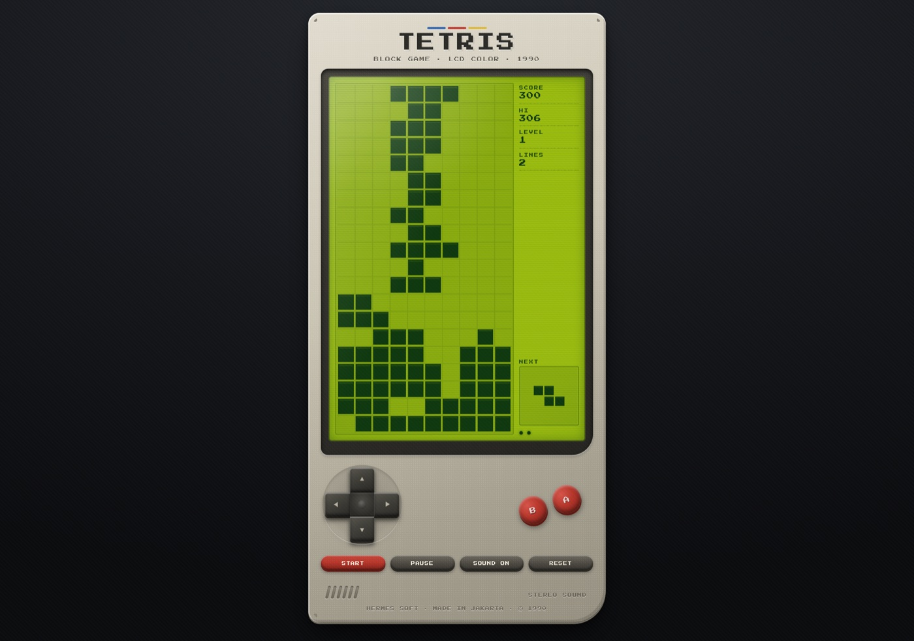

# TETRIS — Handheld Block Game (1990)

Tetris klasik yang jalan langsung di browser, dibungkus dalam replika **handheld LCD era 90-an**:
bodi plastik beige, layar LCD hijau dengan scanline, D-pad, tombol A/B merah, speaker grille,
sampai stiker "© 1990" di bagian bawah. Bukan full screen — device-nya berdiri di tengah halaman
dan mengecil sendiri kalau layar pendek.



## Main sekarang

- **Online:** <https://andriyfm.github.io/tetris-browser-game/>
- **Lokal:** buka `index.html` langsung di browser, atau

  ```bash
  python3 -m http.server 8000
  # lalu buka http://localhost:8000
  ```

Tanpa install, tanpa build step, tanpa dependency. Font pixel sudah di-vendor lokal,
jadi game tetap tampil benar walau offline.

## Kontrol

| Aksi | Keyboard | Tombol di device |
| --- | --- | --- |
| Geser kiri / kanan | `←` `→` | D-pad kiri / kanan |
| Turun perlahan (+1 poin/sel) | `↓` | D-pad bawah |
| Jatuh langsung (+2 poin/sel) | `Space` | Tombol **A** |
| Putar searah jarum jam | `↑` / `X` | D-pad atas |
| Putar balik | `Z` | Tombol **B** |
| Pause / lanjut | `P` / `Esc` | `PAUSE` |
| Mulai / ulang | `Enter` / `Space` | `START` |
| Reset ke layar awal | `R` | `RESET` |
| Suara on/off | — | `SOUND ON` |

Tombol di device bisa diklik/ditap dan punya auto-repeat kalau ditahan (geser & turun).
Semua tombol juga punya label `aria-label`, jadi bisa dipakai dengan pembaca layar.

## Aturan & skor

- Papan 10 × 20, tujuh tetromino (I, J, L, O, S, T, Z).
- **7-bag randomizer** — setiap tipe keluar sekali sebelum kantong diacak ulang,
  jadi tidak ada rentetan S/Z yang bikin frustrasi.
- Rotasi dua arah dengan wall kick sederhana (coba geser 1–2 sel, lalu naik 1 sel).
- Skor klasik: single **40**, double **100**, triple **300**, tetris **1200** — dikali level.
- Level naik setiap 10 baris; kecepatan jatuh mengikuti tabel 21 tingkat.
- Hi-score disimpan di `localStorage` (`tetris-hi`).
- Ada *ghost piece* samar sebagai penanda posisi jatuh.

## Struktur project

```
.
├── index.html               # markup device + layar + kontrol
├── styles.css               # bodi plastik, bezel, LCD, tombol, media query
├── tetris.js                # mesin game (canvas, rotasi, skor, SFX, auto-fit)
├── assets/fonts/            # Press Start 2P (woff2) + lisensi OFL
├── docs/screenshot.jpg      # tangkapan layar untuk README
└── tests/smoke.console.js   # smoke test (dijalankan di Console browser)
```

## Detail teknis

- **Rendering:** satu `<canvas>` 180 × 360 (10 × 20 sel @18px) diskalakan dengan
  `image-rendering: pixelated`; context di-scale mengikuti `devicePixelRatio` agar tajam di layar HiDPI.
- **Loop:** `requestAnimationFrame` dengan akumulator waktu dan `dt` di-clamp 100 ms,
  jadi tidak melompat saat tab sempat tidak aktif.
- **Audio:** WebAudio `square` oscillator untuk SFX 8-bit (gerak, putar, kunci, line clear,
  level up, game over). Tidak ada file audio.
- **Auto-fit:** tinggi device diukur, lalu `transform: scale()` dipakai kalau viewport pendek;
  sisa ruang ditarik lewat margin negatif supaya halaman tidak ikut memanjang.
- **Aksesibilitas:** overlay status punya teks jelas, tombol punya `aria-label`/`aria-pressed`,
  dan animasi kedip dimatikan pada `prefers-reduced-motion`.

## Debug & pengujian

Tambahkan `?debug=1` pada URL untuk membuka `window.__tetris`
(`board`, `score`, `lines`, `lockPiece`, `setBoard`, `setPiece`, …). Dipakai untuk uji otomatis
lewat browser, misalnya memaksa satu baris penuh untuk memverifikasi line clear:

```js
const T = window.__tetris;
T.start();
const b = T.board.map(r => r.slice());
for (let x = 1; x < 10; x++) b[19][x] = 1;   // sisakan lubang di kolom 0
T.setBoard(b);
T.setPiece({ type: 'X', m: [[1]], x: 0, y: 19 });
T.lockPiece();                                // → lines: 1, score: 40
```

**Smoke test:** buka `index.html?debug=1`, lalu tempel isi `tests/smoke.console.js`
ke Console DevTools. Hasilnya 7 cek PASS/FAIL (start, skor, line clear, geser baris, game over).

## Lisensi

- Kode: **MIT** — lihat [LICENSE](LICENSE).
- Font *Press Start 2P*: **SIL Open Font License 1.1** — lihat `assets/fonts/OFL.txt`.

Tetris adalah merek dagang Tetris Holding. Project ini dibuat untuk latihan/tujuan edukasi
dan tidak berafiliasi dengan pemegang merek.
